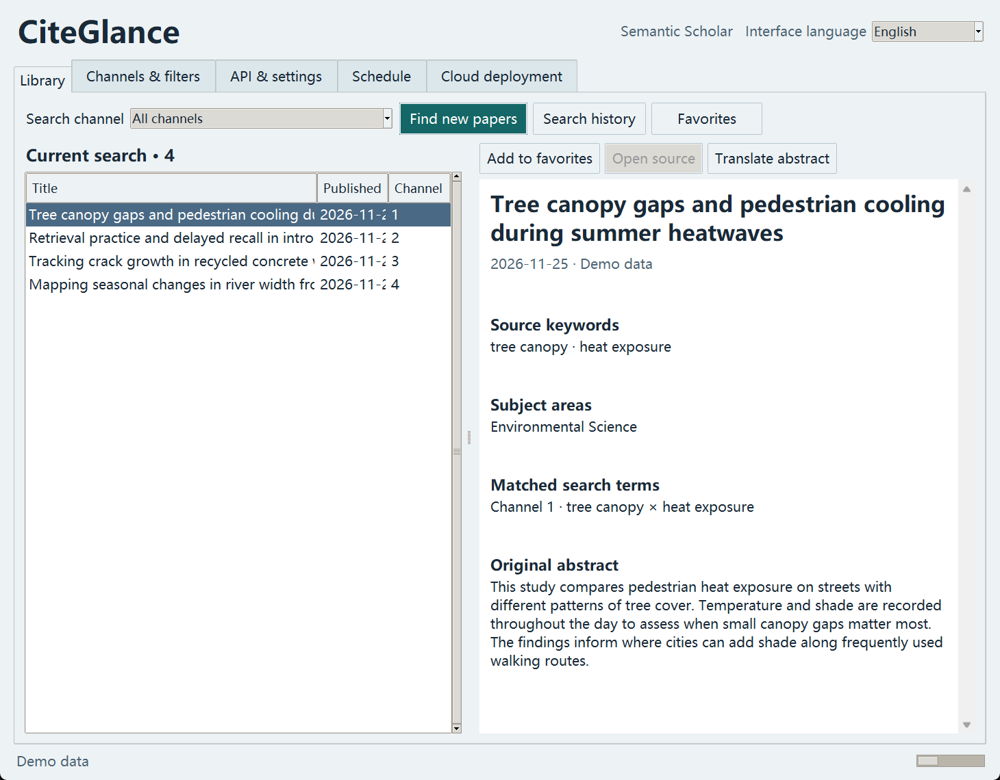

# CiteGlance

[简体中文](README.md) · [日本語](README.ja.md) · **English**

CiteGlance is a Windows app for tracking new research papers. Create search channels for your research topics, schedule searches, and review abstracts, matching keywords, favorites, and saved translations in one place.

**The Windows app supports Semantic Scholar, OpenAlex, Crossref, and custom JSON APIs.** Manual and scheduled searches use the source selected in **API & settings**. The bundled CLI, Docker service, and GitHub Actions workflow currently use Semantic Scholar for search.

*The screenshot uses fictional papers from several disciplines. A fresh copy starts with an empty channel list and no exclusions.*

## Features

| Feature | What you can do |
| --- | --- |
| Scheduled search | Search every 24 hours by default while the app is running. Set an interval in minutes, hours, or days, or pause the schedule. See the last start and next expected search. |
| Custom channels | Match one term from group A and one from group B. Add optional scope terms and channel-specific or global exclusions. |
| Local paper library | Review titles, authors, publication dates, source keywords, subject areas, and abstracts. Results are deduplicated in the library, where you can browse history and save favorites. |
| Abstract translation | Translate with DeepL, an OpenAI-compatible service, or LibreTranslate. Choose Simplified Chinese, Japanese, or English. Translations are saved locally. |
| Three interface languages | Switch between Simplified Chinese, Japanese, and English. The app remembers your choice. |
| Cloud deployment | In **Cloud deployment**, set a daily search time or an interval and deploy or update the Docker service over SSH. Use Telegram to check its status or start a search. |

## Quick start

1. Download and extract the source ZIP. You need **Python 3.10+** with **Tkinter**.
2. Double-click `launch_client.cmd` or run `python -X utf8 desktop.py` from the project folder. Select **English** in the language menu in the upper-right corner.
3. Open **Channels & filters**, name your first channel, and enter terms in groups A and B.
4. Open **API & settings** and choose a search source. If it requires authentication, enter your own API key and save the settings. Crossref is available without an API key.
5. In **Library**, select a channel and click **Find new papers**. Use **Schedule** to change the automatic search interval.

## Desktop search sources

- **Semantic Scholar** is selected by default. Its records may include abstracts and subject areas. Use an API key issued to you.
- **OpenAlex** provides paper metadata and indexed keywords. With an API key, the app can retrieve additional pages.
- **Crossref** offers public search without an API key. Abstract availability varies by record and metadata provider.
- **Custom JSON** supports common REST APIs with GET or POST, API key authentication, field mapping, and cursor pagination. Search syntax and available metadata depend on the service.

The repository publishes the search adapters and public service endpoints. Custom JSON configuration is stored locally. On Windows, **Remember keys entered here (Windows encryption)** stores keys in encrypted form. Clear the checkbox to keep a newly entered key for the current session. GitHub Actions reads credentials from the repository's Actions secrets.

## Local and cloud deployment

| Mode | Search sources | Operation and scheduling |
| --- | --- | --- |
| Windows app | Semantic Scholar, OpenAlex, Crossref, Custom JSON | Run a manual search, or schedule searches while the app is open and the computer is awake. |
| CLI `bot.py` | Semantic Scholar | Run manually to preview results in the terminal or send a Telegram digest. |
| Docker service | Semantic Scholar | Set **Cloud deployment → Daily search time (JST)**. Leave it blank to use the interval. [Set up Docker scheduling](docs/server.en.md#deploy-from-the-windows-app) |
| GitHub Actions | Semantic Scholar | Runs at 09:07 Japan time by default. Edit the workflow's `cron` to change the time. Each run searches the previous calendar day and sends a Telegram digest. [Change the schedule](docs/usage.en.md#change-the-github-actions-schedule) |

[User guide, API setup, and GitHub Actions](docs/usage.en.md) · [Linux server deployment](docs/server.en.md)
