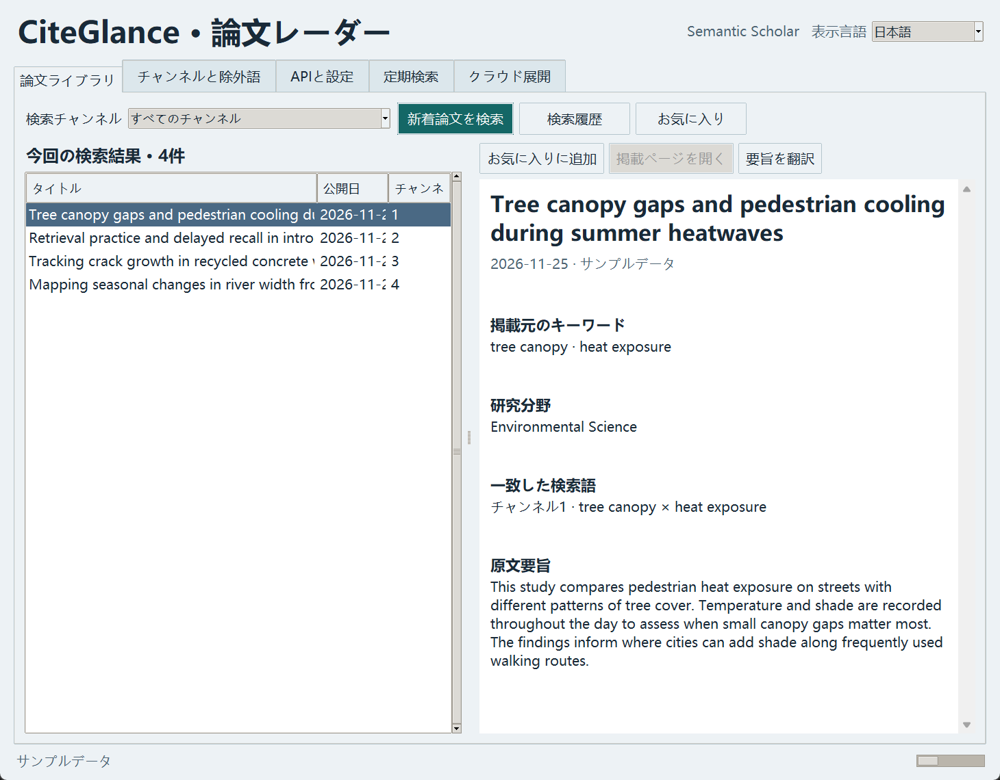

# CiteGlance

[简体中文](README.md) · **日本語** · [English](README.en.md)

CiteGlance は、新着論文を追跡する Windows アプリです。研究テーマごとに検索チャンネルを作成し、定期検索を設定できます。要旨、一致した検索語、お気に入り、保存した翻訳を一つの画面で確認できます。

**Windows アプリは Semantic Scholar、OpenAlex、Crossref、カスタム JSON API に対応しています。** 手動検索と定期検索は、どちらも「APIと設定」で選んだ検索元を使用します。同梱のコマンドライン、Docker 常駐サービス、GitHub Actions の検索元は現在 Semantic Scholar です。

*画面の論文は、複数の分野を題材にした架空の例です。初回起動時のチャンネルと除外語は空です。*

## 主な機能

| 機能 | 内容 |
| --- | --- |
| 定期検索 | アプリの起動中に、初期設定では 24 時間ごとに検索します。間隔は分・時間・日単位で設定でき、一時停止も可能です。前回の開始時刻と次回予定を確認できます。 |
| チャンネル設定 | A グループと B グループからそれぞれ一つ以上に一致する論文を探します。分野の絞り込み、チャンネルごとの除外語、全チャンネル共通の除外語を設定できます。 |
| ローカルの論文ライブラリ | 論文名、著者、出版日、検索元のキーワード、分野、要旨を閲覧できます。検索結果は重複を除いて保存され、履歴の閲覧やお気に入りへの登録が可能です。 |
| 要旨の翻訳 | DeepL、OpenAI 互換サービス、LibreTranslate を使い、簡体字中国語・日本語・英語に翻訳できます。訳文は端末に保存されます。 |
| 3 言語の画面表示 | 簡体字中国語、日本語、英語を切り替えられます。選択した表示言語は保存されます。 |
| クラウド展開 | 「クラウド展開」で毎日の検索時刻または検索間隔を設定し、SSH 経由で Docker サービスを展開・更新できます。Telegram から稼働状況の確認と手動検索ができます。 |

## クイックスタート

1. ソース ZIP をダウンロードして展開します。**Python 3.10 以降**と **Tkinter** が必要です。
2. `launch_client.cmd` をダブルクリックするか、プロジェクトのフォルダーで `python -X utf8 desktop.py` を実行します。画面右上の言語メニューで「日本語」を選びます。
3. 「チャンネルと除外語」で最初のチャンネルを作成し、名前と A・B 両グループの検索語を入力します。
4. 「APIと設定」で検索元を選びます。認証が必要なサービスでは、自分で取得した API キーを入力して保存します。Crossref は API キーなしで利用できます。
5. 「論文ライブラリ」でチャンネルを選択し、「新着論文を検索」をクリックします。自動検索の間隔は「定期検索」で変更できます。

## デスクトップ版の検索元

- **Semantic Scholar** は初期設定の検索元です。データによって要旨や分野を取得できます。利用には自分で取得した API キーを入力します。
- **OpenAlex** から論文メタデータと索引キーワードを取得できます。API キーを設定すると、検索結果の次ページも取得できます。
- **Crossref** はキーなしで公開 API を利用できます。要旨の有無はメタデータの提供元や論文によって異なります。
- **カスタム JSON** は、GET・POST、API キー認証、レスポンス項目の対応付け、カーソルによるページ送りに対応しています。検索構文と取得できる情報は接続先によって異なります。

リポジトリには、検索アダプターのコードと各サービスの公開エンドポイントを掲載しています。カスタム JSON の接続設定は端末に保存されます。Windows で「入力したキーを保存（Windowsで暗号化）」を選ぶと、キーが暗号化されて保存されます。チェックを外して入力したキーは、その起動中だけ使用します。GitHub Actions の認証情報はリポジトリの Actions シークレットに設定します。

## ローカル実行とクラウド展開

| 実行方法 | 検索元 | 実行とスケジュール |
| --- | --- | --- |
| Windows アプリ | Semantic Scholar、OpenAlex、Crossref、カスタム JSON | 手動検索が可能です。定期検索はアプリの起動中かつ PC がスリープしていない間に実行されます。 |
| コマンドライン `bot.py` | Semantic Scholar | 手動で実行し、端末に結果を表示するか Telegram にダイジェストを送信します。 |
| Docker 常駐サービス | Semantic Scholar | 「クラウド展開 → 毎日の検索時刻（JST）」で時刻を指定します。空欄なら検索間隔が適用されます。 [設定手順](docs/server.ja.md#windows-アプリから展開する) |
| GitHub Actions | Semantic Scholar | 初期設定は毎日 09:07（日本時間）です。ワークフローの `cron` を編集すると変更できます。前日に出版された論文を検索し、Telegram にダイジェストを送信します。 [検索時刻の変更](docs/usage.ja.md#github-actions-の検索時刻を変更する) |

[使い方・API 設定・GitHub Actions](docs/usage.ja.md) · [Linux サーバーへの展開](docs/server.ja.md)
