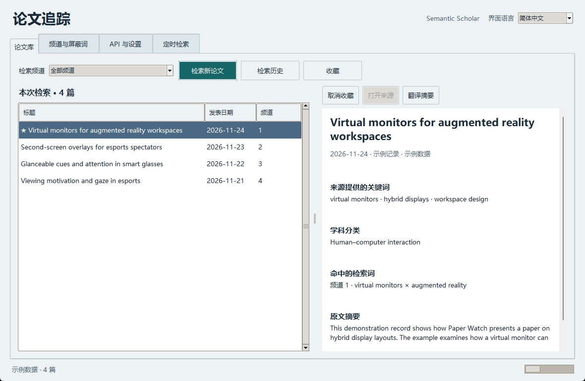

# CiteGlance · 文献雷达

CiteGlance 是一个 Windows 学术论文追踪客户端。你可以为任何研究主题建立检索频道，定时查找近期论文，在同一个窗口阅读摘要、核对关键词、收藏论文和保存译文。

**Windows 客户端支持 Semantic Scholar、OpenAlex、Crossref 和自定义 JSON API。** 手动和定时检索都使用你在「API 与设置」选择的来源。仓库附带的命令行、Docker 常驻服务和 GitHub Actions 目前仅支持 Semantic Scholar。

The Windows desktop app supports Semantic Scholar, OpenAlex, Crossref, and configurable JSON APIs for manual and scheduled searches. The bundled CLI, Docker service, and GitHub Actions workflow currently support Semantic Scholar only.

*截图使用不同学科的演示题目。首次打开时，频道和屏蔽词均为空。*

## 功能

| 功能 | 用法 |
| --- | --- |
| 定时检索 | 客户端运行期间自动检索，默认每 24 小时一次。间隔可按分钟、小时或天调整，也可暂停。页面显示上次启动及下次预计检索时间。 |
| 自定义频道 | 按 A／B 组词组交叉匹配，支持可选的领域限定、单频道屏蔽词和全局屏蔽词。 |
| 本地论文库 | 查看标题、作者、发表日期、来源关键词、学科分类和摘要。检索结果自动去重，可收藏并查看历史。 |
| 摘要翻译 | 通过 DeepL、OpenAI 兼容服务或 LibreTranslate 翻译摘要，可选简体中文、日语和英语。已有译文保存在本机。 |
| 三语界面 | 简体中文、English、日本語可即时切换，选择会记住。 |
| 可选云端运行 | 在「云端部署」页设置每日固定检索时间或检索间隔，通过 SSH 部署或更新 Docker 服务。部署后可在 Telegram 查询状态或立即检索。 |

## 快速开始

1. 下载并解压源码，确认已安装 **Python 3.10+** 和随标准安装提供的 **Tkinter**。
2. 双击 `launch_client.cmd`。也可以在项目目录运行 `python -X utf8 desktop.py`。
3. 在「频道与屏蔽词」创建第一个频道，填写频道名称与 A、B 两组检索词。
4. 在「API 与设置」选择检索来源。需要认证时，填入该服务发给你的 API Key 并保存。想先试用，可以选择无需 API Key 的 Crossref。
5. 回到「论文库」，选择频道并点击「检索新论文」。自动检索间隔可在「定时检索」调整。

## 桌面客户端的检索来源

- **Semantic Scholar** 是桌面端默认选中的第三方检索服务，支持论文检索、摘要和学科分类。使用时需填写你自己申请的 API Key。
- **OpenAlex** 提供论文元数据和索引关键词。配置 API Key 后，客户端可继续翻查后续结果。
- **Crossref** 支持无需密钥的公开检索。摘要由元数据提供方提交，覆盖因论文而异。
- **自定义 JSON** 支持常见 REST API 的 GET／POST、密钥认证、字段映射及游标分页。接口可用的检索语法及元数据范围取决于服务。

项目公开的是检索适配代码和服务的公共接口地址。自定义 JSON 的接口配置保存在本机。勾选「记住本次输入的密钥」时，桌面端用 Windows 加密保存 API Key。取消勾选时，输入的密钥只在当前会话使用。GitHub Actions 的密钥通过仓库的 Actions Secrets 配置。

## 本地运行与云端部署

| 方式 | 支持的检索来源 | 运行方式 |
| --- | --- | --- |
| Windows 客户端 | Semantic Scholar、OpenAlex、Crossref、自定义 JSON API | 手动检索，或在客户端打开且设备唤醒时定时检索 |
| 命令行 `bot.py` | Semantic Scholar | 手动运行，终端预览或推送 Telegram 简报 |
| Docker 常驻服务 | Semantic Scholar | Linux 服务器按每日固定时间（JST）或间隔推送 Telegram 简报，支持 `/status` 和 `/search` |
| GitHub Actions | Semantic Scholar | 通过仓库 Secrets 配置密钥，启用后默认每天日本时间 09:07 检索前一自然日并推送 Telegram 简报 |

[使用指南、API 配置与 GitHub Actions 部署](docs/usage.md) · [Linux 服务器常驻部署](docs/server.md)
