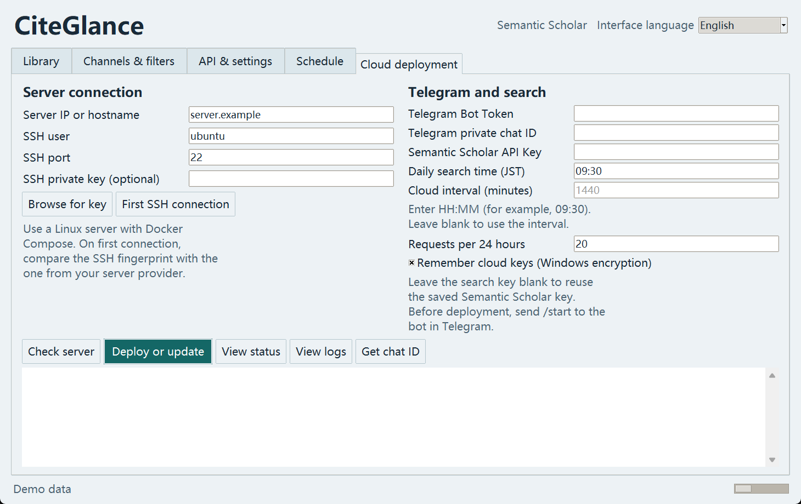

# CiteGlance on a Linux server

[简体中文](server.md) · [日本語](server.ja.md) · **English**

[Project home](../README.en.md) · [User and deployment guide](usage.en.md)

The Docker service runs continuously on a Linux server. It searches the channels in `channels.json` with Semantic Scholar and sends digests to a designated private Telegram chat. The service receives commands through Telegram long polling. It needs outbound HTTPS access to Semantic Scholar and Telegram.

| Telegram command | What it does |
| --- | --- |
| `/status` | Shows service status, the next expected search, recent request usage, and the last outcome. |
| `/search` | Searches all channels immediately and sends a digest after the search. |
| `/help` | Lists available commands. |

## Deploy from the Windows app

1. Prepare a Linux server with Python 3, Docker Engine, and Docker Compose. Add your SSH public key. The SSH user must be able to run Docker.
2. Open **Cloud deployment**. Enter the server address, SSH user, and port. Click **Browse for key** to use a specific private key file. Leave it blank to use the default SSH key or a key loaded in your SSH agent. On first use, click **First SSH connection**, compare the fingerprint with the one from your server provider, then click **Check server**.
3. Create a bot with Telegram's `@BotFather` and send it `/start`. Enter its token and click **Get chat ID**, or enter your existing private chat ID. Enter your **Semantic Scholar API Key** or leave it blank to reuse the key saved in the app. The app sends deployment credentials to the server over SSH.
4. Save at least one channel. Enter a 24-hour time such as `09:30` in **Daily search time (JST)**. Leave it blank to use **Cloud interval (minutes)**. Set a request limit and click **Deploy or update**. Send `/status` in Telegram to see the schedule and the next expected search.

Click **Deploy or update** again after editing channels, the search schedule, or the program files. Deployment reuses the `paper-watch` Docker project and its data volume. The service can run with the Windows app closed.

When you enable a daily time or change it, the first search waits for the next scheduled occurrence. If the server misses a run while it is offline, it runs once when it comes back. If the request budget is exhausted, it waits for capacity to return. Manual searches started with `/search` share that budget and keep the fixed daily schedule in place.

### Check your first SSH login

- A prompt such as `username@server:~$` means you are signed in. Run `whoami` to confirm the Linux username. Enter it exactly as shown in the **SSH user** field.
- A prompt such as `username@server's password:` expects that Linux user's password. The terminal hides your input. If you see `Permission denied`, press `Ctrl+C`, check the username and login method in your provider's console, and reconnect.
- **Check server** and **Deploy or update** use SSH key authentication. If you can currently log in with a password, add the Windows SSH **public key** to that Linux user's `~/.ssh/authorized_keys`. The default Windows OpenSSH Ed25519 public key path is `%USERPROFILE%\.ssh\id_ed25519.pub`. If you need a key, run `ssh-keygen -t ed25519` in Windows PowerShell and keep any existing key files. Append one public key per line while preserving the existing entries. [Windows OpenSSH key management](https://learn.microsoft.com/en-us/windows-server/administration/openssh/openssh_keymanagement)
- In the SSH terminal, run the following commands to check Docker Compose and confirm that this user can access Docker Engine.

~~~~bash
docker compose version
docker info --format '{{.ServerVersion}}'
~~~~

Run `exit` to end the SSH session. Return to the app, use the corresponding private key or the SSH default, and click **Check server**.

## Deploy from the server terminal

### 1. Prepare the server and Telegram bot

- Use a Linux server that stays online and can run Docker Engine and the Compose plugin. [Docker Engine installation on Ubuntu](https://docs.docker.com/engine/install/ubuntu/)
- Create a bot with `@BotFather`, open a private chat with it, and send `/start`. From the Windows app folder, run `python -X utf8 bot.py --chat-id` and paste the token at the hidden prompt to get your numeric private chat ID.
- Extract the source on the server or clone the GitHub repository. Run the following commands from the project root on the server.
- Configure at least one channel in `channels.json`. You can copy the channel configuration you saved in the Windows app.
- Keep one long-polling process per bot token. The server counts its own Semantic Scholar requests, so calls from other schedulers using the same key are counted separately. When switching deployment modes, you can disable the previous GitHub Actions or desktop schedule.

### 2. Configure the server

Copy the template and edit the non-secret settings.

~~~~bash
cp .env.example .env
nano .env
~~~~

Set `TELEGRAM_CHAT_ID`. Set `PAPER_WATCH_DAILY_TIME=09:30` for a daily search at 09:30 Japan Standard Time. Leave it blank to use `PAPER_WATCH_INTERVAL_MINUTES`. The default is `1440` (every 24 hours). Use `60` for an hourly search. `PAPER_WATCH_DAILY_BUDGET` defaults to 20 requests per rolling 24 hours. Scheduled and manual searches share it, including pagination and retries. As a baseline, multiply the number of channels by the number of searches per day.

The following Bash commands prompt for both credentials and hide your input. The secrets directory is accessible to the current server user. The files can be read by the non-root user inside the container.

~~~~bash
install -d -m 700 .secrets
(umask 077
read -rsp 'Semantic Scholar API Key: ' PAPER_WATCH_INPUT
printf '\n'
printf '%s\n' "$PAPER_WATCH_INPUT" > .secrets/semantic_scholar_api_key
read -rsp 'Telegram Bot Token: ' PAPER_WATCH_INPUT
printf '\n'
printf '%s\n' "$PAPER_WATCH_INPUT" > .secrets/telegram_bot_token
chmod 444 .secrets/semantic_scholar_api_key .secrets/telegram_bot_token)
~~~~

### 3. Start and verify the service

~~~~bash
docker compose up -d --build
docker compose ps
docker compose logs --tail=50 paper-watch
~~~~

Send `/status` in the private Telegram chat to confirm the bot responds. With a fixed daily time, the service waits for the next scheduled occurrence. In interval mode, it searches on first startup if there is enough request capacity. Docker can restart the container, and the SQLite volume keeps search progress, previously reported papers, request usage, and the Telegram update cursor.

## Updates and maintenance

- After editing `channels.json` or `.env`, run `docker compose up -d --force-recreate`. After updating the code, run `docker compose up -d --build`.
- Use `docker compose logs -f paper-watch` to follow logs, `docker compose stop` to pause, and `docker compose start` to resume. Keep the `paper-watch-data` volume to retain deduplication and usage history.
- For repeated Telegram `409` errors, check whether another instance or webhook uses the same token. For a `401` error, check the Telegram token and Semantic Scholar key in their respective secrets files.
- The default deployment publishes no container ports. Use the private Telegram chat to interact with the service.
