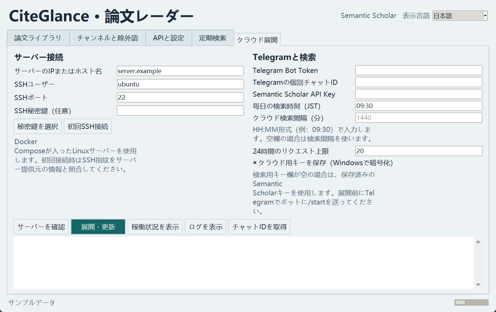

# Linux サーバーで CiteGlance を常時運用する

[简体中文](server.md) · **日本語** · [English](server.en.md)

[プロジェクトのトップ](../README.ja.md) · [使い方と展開手順](usage.ja.md)

Docker 版は Linux サーバー上で常時稼働します。`channels.json` に設定したチャンネルを Semantic Scholar で検索し、指定した Telegram の個別チャットにダイジェストを送信します。Telegram のロングポーリングでコマンドを受け付けます。サーバーから Semantic Scholar と Telegram に HTTPS で接続できる環境が必要です。

| Telegram コマンド | 機能 |
| --- | --- |
| `/status` | 稼働状況、次回予定、直近のリクエスト数、前回の実行結果を表示します。 |
| `/search` | 全チャンネルをすぐに検索し、完了後にダイジェストを送信します。 |
| `/help` | コマンドの一覧を表示します。 |

## Windows アプリから展開する

1. Python 3、Docker Engine、Docker Compose を使える Linux サーバーを用意し、自分の SSH 公開鍵を登録します。SSH で接続するユーザーには Docker を実行する権限が必要です。
2. 「クラウド展開」を開き、サーバーの IP アドレスまたはドメイン、SSH ユーザー、ポートを入力します。特定の秘密鍵を使う場合は「秘密鍵を選択」を押します。既定の鍵や SSH エージェントに読み込んだ鍵を使う場合は空欄で構いません。初回は「初回SSH接続」でサーバー提供元の指紋と照合してから、「サーバーを確認」をクリックします。
3. Telegram の `@BotFather` でボットを作り、個別チャットに `/start` を送ります。トークンを入力し「チャットIDを取得」を押すか、取得済みの個別チャット ID を入力します。「Semantic Scholar API Key」に発行されたキーを入力します。空欄の場合は、アプリに保存された Semantic Scholar キーを使用します。展開用の認証情報は SSH 経由でサーバーに渡されます。
4. チャンネルを一つ以上保存します。「毎日の検索時刻（JST）」に `09:30` などの 24 時間制の時刻を入力します。空欄なら「クラウド検索間隔（分）」が適用されます。リクエスト上限を設定し、「展開・更新」を押します。Telegram に `/status` を送ると、設定したスケジュールと次回予定を確認できます。

チャンネル、検索時刻、プログラムを変更したら、再度「展開・更新」を押します。Docker プロジェクト名 `paper-watch` と既存のデータボリュームが引き継がれます。Windows アプリを終了してもサーバー側の処理は続きます。

固定時刻を初めて設定した場合や時刻を変更した場合は、次にその時刻になったときに検索します。停止中に検索時刻を過ぎた場合は、サーバーの復旧後に一度実行します。リクエスト上限に達すると、利用枠が回復するまで待ちます。`/search` の手動検索も同じ利用枠を使い、固定時刻での次回予定は維持されます。

### 初回の SSH 接続を確認する

- `username@server:~$` のような表示になればログイン済みです。その端末で `whoami` を実行し、表示された Linux ユーザー名を「SSHユーザー」に入力します。
- `username@server's password:` と表示されたら、その Linux ユーザーのパスワードを入力します。入力内容は表示されません。`Permission denied` が出たら `Ctrl+C` で終了し、サーバー提供元の管理画面でユーザー名と認証方法を確認してから再接続します。
- 「サーバーを確認」と「展開・更新」は SSH 鍵で認証します。パスワードでログインできる場合は、Windows の SSH **公開鍵**をその Linux ユーザーの `~/.ssh/authorized_keys` に追加します。Windows OpenSSH の Ed25519 公開鍵の既定パスは `%USERPROFILE%\.ssh\id_ed25519.pub` です。鍵がなければ Windows PowerShell で `ssh-keygen -t ed25519` を実行します。既存の鍵ファイルは残し、公開鍵は既存の設定に一つにつき一行ずつ追記します。 [Windows OpenSSH の鍵管理](https://learn.microsoft.com/en-us/windows-server/administration/openssh/openssh_keymanagement)
- 接続先の端末で次の二つを実行し、Docker Compose が使えることと、SSH ユーザーが Docker Engine にアクセスできることを確認します。

~~~~bash
docker compose version
docker info --format '{{.ServerVersion}}'
~~~~

確認後は `exit` で SSH を終了します。アプリに戻り、対応する秘密鍵または既定の鍵を使用して「サーバーを確認」を押します。

## サーバーのターミナルから展開する

### 1. サーバーと Telegram ボットを準備する

- Docker Engine と Compose プラグインを利用できる、常時稼働の Linux サーバーを用意します。 [Ubuntu への Docker Engine インストール手順](https://docs.docker.com/engine/install/ubuntu/)
- Telegram の `@BotFather` でボットを作り、個別チャットに `/start` を送ります。Windows アプリのフォルダーで `python -X utf8 bot.py --chat-id` を実行し、非表示の入力欄にトークンを貼り付けると個別チャットの数値 ID を取得できます。
- サーバー上でソース ZIP を展開するか、GitHub からクローンします。以下のコマンドはすべてサーバー上のプロジェクトルートで実行します。
- `channels.json` にチャンネルを一つ以上設定します。Windows アプリで保存したチャンネル設定をコピーして使うこともできます。
- 一つのボットトークンには、ロングポーリングを一つだけ起動します。サーバー側で計測できるのは自分のリクエスト数です。同じ Semantic Scholar キーを使う別のスケジューラーの利用量は別途確認します。展開方法を切り替えるときは、以前の GitHub Actions またはデスクトップ版の定期検索を停止できます。

### 2. サーバーを設定する

テンプレートをコピーし、認証情報以外の設定を編集します。

~~~~bash
cp .env.example .env
nano .env
~~~~

`TELEGRAM_CHAT_ID` を設定します。毎日 09:30（日本時間）に検索するには `PAPER_WATCH_DAILY_TIME=09:30` を設定します。空欄にすると `PAPER_WATCH_INTERVAL_MINUTES` が適用され、既定値 `1440` は 24 時間ごと、`60` は 1 時間ごとです。`PAPER_WATCH_DAILY_BUDGET` の既定値は直近 24 時間で 20 リクエストです。ページ送りとリトライを含め、定期検索と手動検索で共有します。1 日の基本使用量は、チャンネル数と検索回数の積で見積もれます。

以下の Bash コマンドを実行すると、二つの認証情報の入力を求められます。入力した値は表示されません。ディレクトリにアクセスできるのは、現在のサーバーユーザーです。ファイルはコンテナの非 root ユーザーが読み取れる権限にします。

~~~~bash
install -d -m 700 .secrets
(umask 077
read -rsp 'Semantic Scholar API Key: ' PAPER_WATCH_INPUT
printf '\n'
printf '%s\n' "$PAPER_WATCH_INPUT" > .secrets/semantic_scholar_api_key
read -rsp 'Telegram Bot Token: ' PAPER_WATCH_INPUT
printf '\n'
printf '%s\n' "$PAPER_WATCH_INPUT" > .secrets/telegram_bot_token
chmod 444 .secrets/semantic_scholar_api_key .secrets/telegram_bot_token)
~~~~

### 3. 起動して動作を確認する

~~~~bash
docker compose up -d --build
docker compose ps
docker compose logs --tail=50 paper-watch
~~~~

Telegram の個別チャットで `/status` を送り、応答を確認します。固定時刻を指定している場合は次の予定時刻まで待ちます。間隔を指定している場合は、初回起動時に利用枠があれば検索を一度実行します。Docker の再起動に伴いコンテナも復帰できます。SQLite のボリュームには、検索の進捗、通知済み論文、リクエスト使用量、Telegram の更新位置が保存されます。

## 更新と保守

- `channels.json` または `.env` を変更した後は `docker compose up -d --force-recreate`、コードを更新した後は `docker compose up -d --build` を実行します。
- ログの表示には `docker compose logs -f paper-watch` を使います。停止は `docker compose stop`、再開は `docker compose start` です。重複判定と使用量の履歴を引き継ぐには `paper-watch-data` ボリュームを残します。
- Telegram の `409` が繰り返し出る場合は、同じトークンを別のインスタンスや webhook が使用していないか確認します。`401` が出る場合は、Telegram トークンと Semantic Scholar キーがそれぞれ対応するシークレットファイルにあることを確認します。
- 既定の展開ではコンテナのポートを公開しません。操作には Telegram の個別チャットを使用します。
