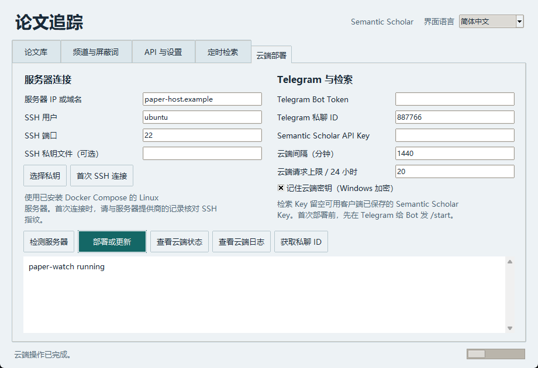

# Linux 服务器常驻部署

[返回项目首页](../README.md)

Docker 版本在 Linux 云服务器上常驻运行。它使用 Semantic Scholar 检索 `channels.json` 中的频道，把简报发到指定的 Telegram 私聊。这个服务通过 Telegram 长轮询接收命令，只需服务器能够向 Semantic Scholar 和 Telegram 发起 HTTPS 请求。

| Telegram 指令 | 用途 |
| --- | --- |
| `/status` | 查看在线状态、下次预计检索、近期请求用量和上次结果 |
| `/search` | 请求立即检索全部频道，完成后接收简报 |
| `/help` | 查看指令说明 |

## 从 Windows 客户端部署

1. 在云服务商控制台准备一台带 Python 3、Docker Engine 和 Docker Compose 的 Linux 服务器，并添加你的 SSH 公钥。SSH 用户需要有 Docker 权限。
2. 打开客户端「云端部署」。填入 IP 或域名、SSH 用户及端口。若有指定的私钥文件，点「选择私钥」；使用默认密钥或已加载到 SSH Agent 的密钥时可留空。首次连接可点「首次 SSH 连接」，和服务器控制台核对指纹，确认后再点「检测服务器」。
3. 通过 Telegram 的 `@BotFather` 创建 Bot，向它发 `/start`。在客户端填写 Token 后点「获取私聊 ID」，或填入已有的 ID。Semantic Scholar Key 一栏留空时可以复用客户端保存的检索密钥。
4. 点「部署或更新」。客户端通过 SSH 传输服务文件和当前频道，设置频率和用量上限，启动 Docker。完成后可用「查看云端状态」「查看云端日志」检查，再到 Telegram 发 `/status` 验证。

之后要同步频道、修改频率或更新程序，再点「部署或更新」。部署使用同一个 Docker 项目及数据卷。服务可在 Windows 客户端关闭后独立运行。

### 首次登录后如何检查

- 如果终端显示 `用户名@服务器:~# Linux 服务器常驻部署

[返回项目首页](../README.md)

Docker 版本在 Linux 云服务器上常驻运行。它使用 Semantic Scholar 检索 `channels.json` 中的频道，把简报发到指定的 Telegram 私聊。这个服务通过 Telegram 长轮询接收命令，只需服务器能够向 Semantic Scholar 和 Telegram 发起 HTTPS 请求。

| Telegram 指令 | 用途 |
| --- | --- |
| `/status` | 查看在线状态、下次预计检索、近期请求用量和上次结果 |
| `/search` | 请求立即检索全部频道，完成后接收简报 |
| `/help` | 查看指令说明 |

## 从 Windows 客户端部署

1. 在云服务商控制台准备一台带 Python 3、Docker Engine 和 Docker Compose 的 Linux 服务器，并添加你的 SSH 公钥。SSH 用户需要有 Docker 权限。
2. 打开客户端「云端部署」。填入 IP 或域名、SSH 用户及端口。若有指定的私钥文件，点「选择私钥」；使用默认密钥或已加载到 SSH Agent 的密钥时可留空。首次连接可点「首次 SSH 连接」，和服务器控制台核对指纹，确认后再点「检测服务器」。
3. 通过 Telegram 的 `@BotFather` 创建 Bot，向它发 `/start`。在客户端填写 Token 后点「获取私聊 ID」，或填入已有的 ID。Semantic Scholar Key 一栏留空时可以复用客户端保存的检索密钥。
4. 点「部署或更新」。客户端通过 SSH 传输服务文件和当前频道，设置频率和用量上限，启动 Docker。完成后可用「查看云端状态」「查看云端日志」检查，再到 Telegram 发 `/status` 验证。

之后要同步频道、修改频率或更新程序，再点「部署或更新」。部署使用同一个 Docker 项目及数据卷。服务可在 Windows 客户端关闭后独立运行。

，说明 SSH 已登录。在该终端运行 `whoami` 可以确认 Linux 用户名。把输出按原有大小写填入客户端的「SSH 用户」。
- 首次连接时出现 `用户名@服务器's password:`，说明用户名已经选定。输入该 Linux 账号的密码即可，终端会隐藏输入。如果提示 `Permission denied`，按 `Ctrl+C` 退出，核对云服务器控制台上的用户名和登录方式，再重新连接。
- 「检测服务器」和「部署或更新」通过 SSH 密钥登录。如果目前可以用密码进入服务器，先把 Windows 上对应的 SSH **公钥**添加到这个 Linux 用户的 `~/.ssh/authorized_keys`。使用 Windows OpenSSH 按默认路径生成 Ed25519 密钥时，公钥文件是 `%USERPROFILE%\.ssh\id_ed25519.pub`。如果还没有 SSH 密钥，可以先在 Windows PowerShell 运行 `ssh-keygen -t ed25519` 生成一对，保留已有的密钥文件。添加公钥时保留原有内容，每把公钥单独一行。 [Windows OpenSSH 密钥文档](https://learn.microsoft.com/en-us/windows-server/administration/openssh/openssh_keymanagement)
- 在已登录的 Linux 终端运行以下两条命令。第一条确认 Compose 是否已安装，第二条确认该 SSH 用户能否访问 Docker Engine。

~~~~bash
docker compose version
docker info --format '{{.ServerVersion}}'
~~~~

检查后输入 `exit` 可结束当前 SSH 会话。回到客户端，选择对应的私钥或使用默认密钥，再点「检测服务器」。

## 从服务器终端部署

### 1. 准备服务器和私人 Bot

- 使用一台持续在线、可运行 Docker Engine 和 Compose 插件的 Linux 服务器。Ubuntu 可按 [Docker 官方安装指南](https://docs.docker.com/engine/install/ubuntu/)安装。
- 在 Telegram 中通过 `@BotFather` 创建 Bot，打开私聊并发送 `/start`。可以在现有 Windows 客户端目录运行 `python -X utf8 bot.py --chat-id`，从隐藏输入框输入 Bot Token，获取自己的数字私聊 ID。
- 将源码包解压到服务器，或在服务器配置好私有仓库访问后克隆此项目。以下命令均在服务器的项目根目录运行。
- 同一个 Bot Token 保留一个长轮询进程。若用同一枚 Semantic Scholar Key 运行其他定时器，服务器无法统计那些调用。切换部署方式时，可以先关闭原有 GitHub Actions 日程或桌面定时检索。

### 2. 配置服务器

复制模板并编辑非密钥设置：

~~~~bash
cp .env.example .env
nano .env
~~~~

填写 `TELEGRAM_CHAT_ID`。`PAPER_WATCH_INTERVAL_MINUTES` 默认是 `1440`，即每 24 小时一轮。要每小时检索，可改为 `60`。`PAPER_WATCH_DAILY_BUDGET` 默认是滚动 24 小时 `20` 次，两种触发方式共用这个额度，分页和重试也计入。四个频道每轮基础需 4 次请求，按每小时检索的基础用量是 96 次／24 小时。额度不足时，服务会等待额度恢复。

以下 Bash 命令会提示你分别粘贴两项密钥，输入时隐藏。密钥文件所在目录仅当前服务器账户可访问，文件设为容器内的非 root 用户可读。

~~~~bash
install -d -m 700 .secrets
(umask 077
read -rsp 'Semantic Scholar API Key: ' PAPER_WATCH_INPUT
printf '\n'
printf '%s\n' "$PAPER_WATCH_INPUT" > .secrets/semantic_scholar_api_key
read -rsp 'Telegram Bot Token: ' PAPER_WATCH_INPUT
printf '\n'
printf '%s\n' "$PAPER_WATCH_INPUT" > .secrets/telegram_bot_token
chmod 444 .secrets/semantic_scholar_api_key .secrets/telegram_bot_token)
~~~~

### 3. 启动并验证

~~~~bash
docker compose up -d --build
docker compose ps
docker compose logs --tail=50 paper-watch
~~~~

在 Telegram 私聊中发 `/status` 验证响应。首次启动且额度充足时，会自动检索一轮。容器可随 Docker 重启恢复，SQLite 数据卷保存检索进度、已报告论文、请求额度和 Telegram 更新位置。

## 更新与维护

- 修改 `channels.json` 或 `.env` 后运行 `docker compose up -d --force-recreate`。更新代码后运行 `docker compose up -d --build`。
- 查看运行日志用 `docker compose logs -f paper-watch`，暂停服务用 `docker compose stop`，之后可用 `docker compose start` 恢复。保留名为 `paper-watch-data` 的数据卷可延续去重和用量记录。
- 若日志反复出现 Telegram `409`，检查这个 Token 是否还被另一个实例或 webhook 使用。若出现 `401`，核对 Telegram Bot Token 与 Semantic Scholar API Key 分别对应的密钥文件。
- 默认没有将容器端口发布到公网。常驻版本的交互入口是 Telegram 私聊。
