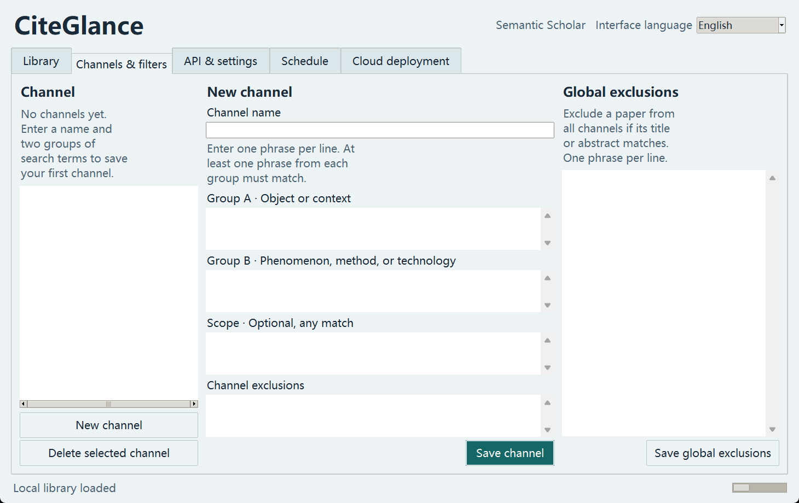
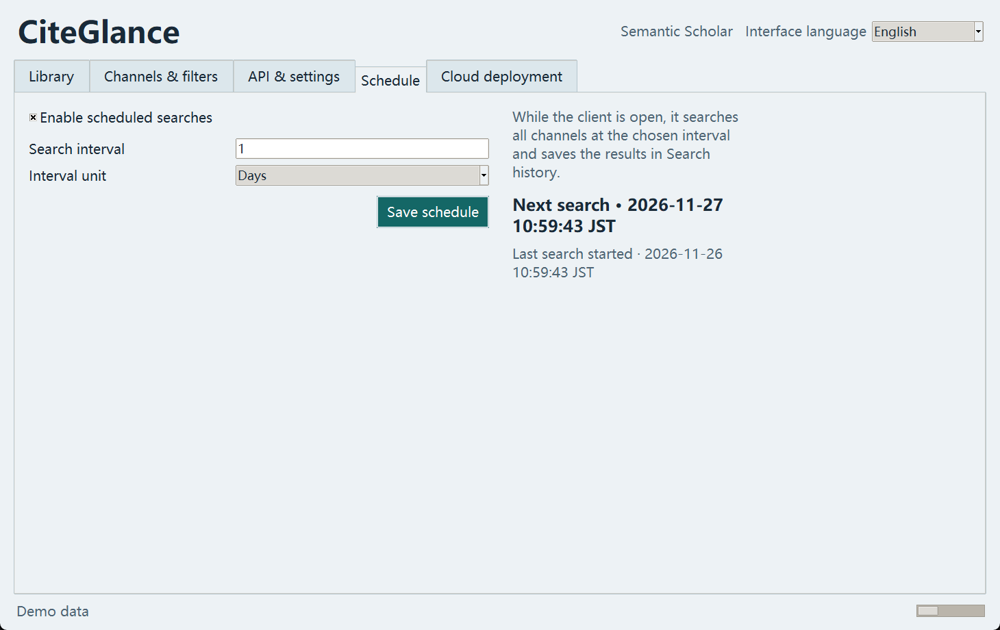

# CiteGlance user and deployment guide

[简体中文](usage.md) · [日本語](usage.ja.md) · **English**

[Project home](../README.en.md) · [Linux server deployment](server.en.md)

## Windows desktop app

Double-click `launch_client.cmd` or run `python -X utf8 desktop.py` from the project folder. The app requires Python 3.10 or later with Tkinter. It uses the Python standard library.

Use **Interface language** in the upper-right corner to select Simplified Chinese, Japanese, or English. The app switches immediately and remembers your choice. The target language for abstract translation has its own setting in **API & settings**.

### Create your first channel

A fresh copy has no channels, search terms, or exclusions. In **Channels & filters**, enter a name and terms for groups A and B, then click **Save channel**. A paper must match at least one term in each group.

If you add optional **Scope** terms, a paper must also match at least one of those. **Channel exclusions** apply to the current channel and **Global exclusions** apply across all channels. Channel settings are saved to `channels.json` in the project folder.

### Schedule desktop searches

Once you have a channel and a search source, the default interval is 24 hours. In **Schedule**, choose an interval in minutes, hours, or days, or pause scheduled searches. Click **Save schedule** to apply changes. The app searches all channels with the saved source and stores results in **Search history**.

The app can run minimized while the computer is awake. It remembers when the last all-channel search started and runs a search on reopening if one is due. A manual all-channel search also resets the next due time. The app shows the last start and next expected search in Japan Standard Time. Each run uses the request budget in **API & settings**. A shorter interval uses more requests per day.

To keep searching while your PC is off, set a daily time or interval in **Cloud deployment** and deploy to a Linux server. You can also use the GitHub Actions workflow described below. [Linux server deployment](server.en.md)

### Configure a search source and API key

1. In **API & settings**, choose a search source. Crossref works without a key. For Semantic Scholar, the default source, enter your key in **Search API key**. For your own endpoint, choose **Custom JSON** and set the endpoint, parameters, authentication, and field mapping. Enter the key in **Search API key**.
2. Click **Save settings**. The search configuration is stored in `%LOCALAPPDATA%\PaperWatch\settings.json` for the current Windows user. **Remember keys entered here (Windows encryption)** is selected by default on Windows and uses DPAPI to store keys in `credentials.json` in the same directory. Clear the checkbox to keep a newly entered key for the current session. The app associates a custom service key with its endpoint.
3. Return to **Library**, select a channel or **All channels**, and click **Find new papers**. Select a result to view the abstract, source keywords, subject areas, and matching channel terms. The local library stores favorites, search results, and completed translations.

### Translate abstracts

In **API & settings**, choose a translation service and a target language, then save the settings. Open a paper and click **Translate abstract**. You can translate to Simplified Chinese, Japanese, or English. The app displays the original and the translation. Saved translations are available when you reopen the paper.

| Service | Required settings |
| --- | --- |
| DeepL | Your DeepL API key and the full `/v2/translate` endpoint for API Free or Pro |
| OpenAI-compatible | Full `/chat/completions` endpoint, model name, and an API key if required. A compatible service can also run locally. |
| LibreTranslate | Full `/translate` endpoint, such as `http://127.0.0.1:5000/translate` for a local service. Install the target language and provide a key if your service requires one. |

When you click **Translate abstract**, the app sends the selected abstract to the configured service. A locally hosted service can translate on the same device. The app calls the service to run the translation model.

### Search APIs

The desktop app supports Semantic Scholar, OpenAlex, Crossref, and Custom JSON. Manual and scheduled desktop searches use the saved source. The `bot.py` CLI, Docker service, and included GitHub Actions workflow currently support Semantic Scholar for searches.

Crossref retrieves candidates from its public API using group A terms before filtering results in the app. Coverage depends on the returned records and available abstracts. Without an OpenAlex key, the app attempts to fetch only the first page. Query syntax, result counts, and abstract and keyword coverage vary by source.

For other HTTP APIs with JSON responses, select **Custom JSON**. Use the example in the app and adjust these fields to match your service.

- `endpoint` and `method` specify the full URL and `GET` or `POST`. Use HTTPS for remote addresses. A local address can use HTTP.
- `params` and `body` define query parameters and a POST JSON body. Both can use `{query}`, `{start_date}`, `{end_date}`, and `{cursor}`.
- `auth` specifies whether the key goes into a header, query parameter, or JSON body and sets the field name and any prefix. Enter the key itself in **Search API key**.
- `items` and `next` are the record-list and next-page paths, such as `results` and `meta.next_cursor`. `map` maps titles, abstracts, keywords, and other fields. `authors[].name` extracts `name` from all objects in an array. Use `$` for a root array.
- `query_style` is `boolean` (AND and OR), `semantic` (plus signs and pipes), or `keywords` (space-separated terms). The app also checks returned titles and abstracts against the channel rules.

Services requiring OAuth sign-in, proprietary request signatures, or XML responses need a dedicated adapter.

## Run on GitHub Actions

The included workflow searches Semantic Scholar and sends a Telegram digest. Once enabled, it runs at **09:07 Japan Standard Time** by default and searches for papers published on the previous calendar day. GitHub may start a scheduled run late, and results depend on when papers are indexed.

Define channels, A and B terms, and exclusions in `channels.json`. Each run allows up to 20 search requests including channel queries, pagination, and retries. Manual runs have their own budget. Requests to Semantic Scholar are at least 1.05 seconds apart. The workflow uses Python 3.10 or later and the standard library.

### 1. Create a Telegram bot

1. Send `/newbot` to Telegram's official `@BotFather` and save the issued token.
2. Open a private chat with the new bot and send `/start`.
3. Extract the project, open a terminal in its folder, and run the following command. Paste the token at the hidden prompt. The command displays the IDs of private chats that recently messaged the bot. For first-time setup, send `/start` from your own account before inviting anyone else.

~~~~powershell
python bot.py --chat-id
~~~~

### 2. Set up the repository

1. Fork this project or upload its source to your own repository. To keep channel terms private, upload the source to a separate private repository. Keep `.github/workflows/paper-watch.yml` and configure at least one channel in `channels.json` on the default branch.
2. Add the following under **Settings → Secrets and variables → Actions → New repository secret**. The workflow references each secret by name. GitHub supplies the value at run time.

   | Secret | Value |
   | --- | --- |
   | `SEMANTIC_SCHOLAR_API_KEY` | Your Semantic Scholar API key |
   | `TELEGRAM_BOT_TOKEN` | Your BotFather token |
   | `TELEGRAM_CHAT_ID` | Your private chat ID from the previous step |

3. Go to **Actions → CiteGlance 每日检索 → Run workflow**. Leave **仅检索并预览，不发送 Telegram** selected to preview the search without sending a message. Review the results in the run log. The preview requires a Semantic Scholar API key.
4. Run it again with the preview checkbox cleared to test Telegram delivery. To enable the daily schedule, add the repository variable `PAPER_WATCH_CLOUD_ENABLED` with the value `true` under **Settings → Secrets and variables → Actions → Variables**. Extra manual runs consume additional API requests.

Scheduled GitHub runs use repository secrets and have read-only access to the source. The regular CLI stores delivery history in `state.json` next to `bot.py`. The desktop app and Docker service each use local SQLite databases. GitHub Actions runs are independent. Repeating a run on the same day can deliver the same papers, and papers indexed late may fall outside the search window.

### Change the GitHub Actions schedule

Edit `on.schedule` in `.github/workflows/paper-watch.yml` on the default branch of your repository. The first two cron fields are minute and hour. With `timezone: 'Asia/Tokyo'`, set `cron` to `'30 9 * * *'` for 09:30 every day in Japan Standard Time.

## Search and digest behavior

- Each channel matches any term from group A and any term from group B. Results are checked against titles, abstracts, and exclusions.
- The Docker service and the regular CLI initially look back 14 calendar days. Later runs keep a rolling window and can resume from a channel's last successful date after a gap. Semantic Scholar searches use publication dates. Records without a precise date or indexed after the window may be missed.
- Papers are deduplicated by DOI, Semantic Scholar ID, arXiv ID, or normalized title. Matches across channels are merged. If a preprint and its published version with the same title appear in one run, the published version is preferred.
- Digests include the title, publication date, venue, matching terms, and a DOI or Semantic Scholar link. Entries are grouped by channel and sorted by publication date.
- The regular CLI and Docker service record papers after Telegram confirms delivery. If the process is interrupted after delivery and before recording it, a subsequent run can resend the same entries. Incomplete channel searches appear in the digest and cause a GitHub Actions run to report a failure.
- The GitHub workflow's default 20-request budget applies per run. Recalculate daily demand if you schedule more frequent runs.

[Semantic Scholar API](https://api.semanticscholar.org/api-docs) · [Telegram Bot API](https://core.telegram.org/bots/api) · [GitHub Actions schedule syntax](https://docs.github.com/en/actions/reference/workflows-and-actions/workflow-syntax#onschedule)
