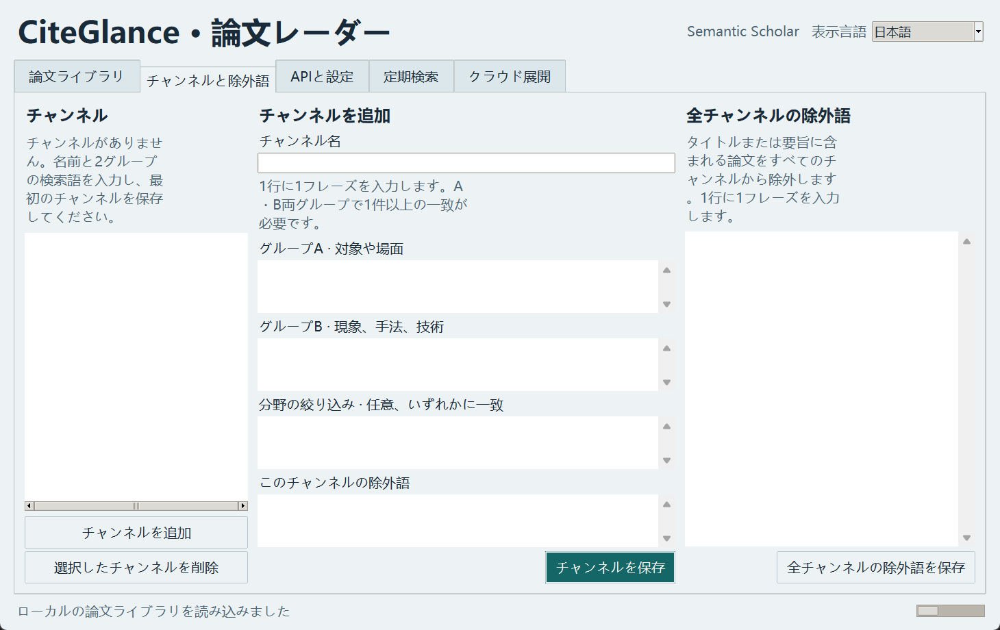
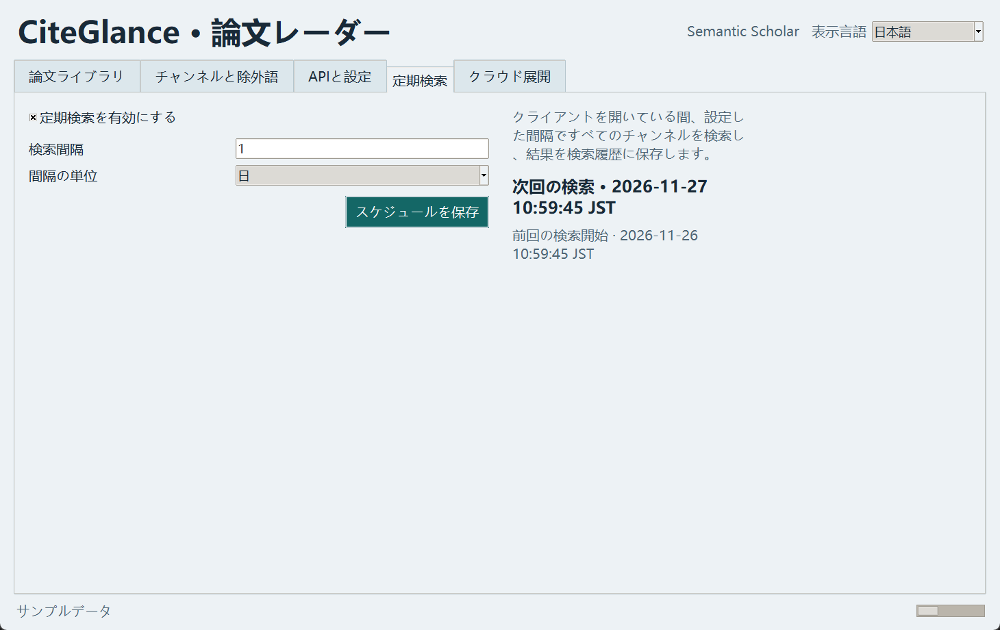

# CiteGlance の使い方と展開手順

[简体中文](usage.md) · **日本語** · [English](usage.en.md)

[プロジェクトのトップ](../README.ja.md) · [Linux サーバーへの展開](server.ja.md)

## Windows アプリ

`launch_client.cmd` をダブルクリックするか、プロジェクトのフォルダーで `python -X utf8 desktop.py` を実行します。Tkinter を含む Python 3.10 以降が必要です。Python の標準ライブラリで動作します。

右上の「表示言語」で簡体字中国語、日本語、英語を選びます。表示はすぐに切り替わり、選択内容は保存されます。要旨の翻訳先は「APIと設定」で別途選べます。

### 最初のチャンネルを作る

初回起動時のチャンネル、検索語、除外語は空です。「チャンネルと除外語」で名前と A・B 両グループの検索語を入力し、「チャンネルを保存」をクリックします。論文は各グループの語に一つ以上一致する必要があります。

「分野の絞り込み」を設定した場合は、その語にも一つ以上一致する必要があります。「このチャンネルの除外語」は選択中のチャンネルに、「全チャンネルの除外語」はすべてのチャンネルに適用されます。チャンネル設定はプロジェクト内の `channels.json` に保存されます。

### デスクトップ版で定期検索する

チャンネルと検索元を設定すると、初期設定では 24 時間ごとに検索します。「定期検索」で間隔を分・時間・日単位に変更したり、スケジュールを一時停止したりできます。「スケジュールを保存」を押すとすぐに反映されます。保存した検索元で全チャンネルを検索し、結果を「検索履歴」に保存します。

PC がスリープしていなければ、アプリを最小化しても定期検索は続きます。全チャンネルの検索を前回開始した時刻が保存され、予定時刻を過ぎてから再起動すると検索を実行します。全チャンネルを手動検索した場合も、次回予定が更新されます。前回の開始時刻と次回の予定時刻は日本時間で表示されます。1 回の検索には「APIと設定」のリクエスト上限が適用されます。間隔を短くすると、1 日当たりのリクエスト数が増えます。

PC の電源を切っている間も検索するには、「クラウド展開」で毎日の時刻または間隔を設定し、Linux サーバーに展開します。後述の GitHub Actions ワークフローも利用できます。 [Linux サーバーへの展開](server.ja.md)

### 検索元と API キーを設定する

1. 「APIと設定」で検索元を選びます。Crossref はキーなしで利用できます。初期設定の Semantic Scholar を使う場合は、「検索用APIキー」に発行されたキーを入力します。自分の JSON API を使う場合は「カスタムJSON」を選び、接続先、パラメーター、認証方法、項目の対応を設定します。キーは「検索用APIキー」に入力します。
2. 「設定を保存」をクリックします。接続設定は現在の Windows ユーザーの `%LOCALAPPDATA%\PaperWatch\settings.json` に保存されます。Windows では「入力したキーを保存（Windowsで暗号化）」が既定で有効です。キーは Windows DPAPI で暗号化され、同じフォルダーの `credentials.json` に保存されます。チェックを外して入力したキーはその起動中だけ使用します。カスタムサービスのキーは接続先ごとに管理されます。
3. 「論文ライブラリ」に戻り、チャンネルまたは「すべてのチャンネル」を選んで「新着論文を検索」をクリックします。論文を選ぶと、要旨、検索元のキーワード、分野、一致した検索語を確認できます。お気に入り、検索結果、訳文はローカルのライブラリに保存されます。

### 要旨を翻訳する

「APIと設定」で翻訳サービスと翻訳先の言語を選び、保存します。論文の詳細画面で「要旨を翻訳」をクリックします。翻訳先は簡体字中国語、日本語、英語から選べます。原文と訳文が表示され、翻訳済みの論文を開き直すと保存した訳文を確認できます。

| サービス | 必要な設定 |
| --- | --- |
| DeepL | DeepL で発行された API キーと、API Free または Pro の完全な `/v2/translate` URL |
| OpenAI 互換 | 完全な `/chat/completions` URL、モデル名、必要に応じて API キー。ローカルで動作する互換サービスも設定できます。 |
| LibreTranslate | 完全な `/translate` URL。ローカルで動かす場合は、たとえば `http://127.0.0.1:5000/translate` を指定します。対象言語をインストールし、必要に応じてキーを設定します。 |

「要旨を翻訳」を押すと、選択した論文の要旨が指定した翻訳サービスに送られます。ローカルのサービスを選べば、同じ端末で翻訳できます。翻訳モデルは接続先のサービスで動作します。

### 検索 API

デスクトップ版は Semantic Scholar、OpenAlex、Crossref、カスタム JSON に対応しています。手動検索と定期検索には保存した検索元が使われます。同梱の `bot.py`、Docker 常駐サービス、GitHub Actions が対応する検索元は、現在 Semantic Scholar です。

Crossref では公開 API に A グループの語を送り、取得した候補をアプリ側で絞り込みます。検索範囲は候補の取得状況や要旨の有無に左右されます。OpenAlex のキーを設定していない場合、アプリは最初のページのみ取得を試みます。検索構文、取得件数、要旨やキーワードの有無は検索元によって異なります。

JSON を返す別の HTTP API に接続するには「カスタムJSON」を選びます。画面にある記入例を参考に、接続先に合わせて次の項目を設定します。

- `endpoint` と `method` に完全な URL と `GET` または `POST` を指定します。外部の接続先には HTTPS を使用します。ローカルの接続先には HTTP も使用できます。
- `params` と `body` にクエリパラメーターと POST の JSON 本文を設定します。`{query}`、`{start_date}`、`{end_date}`、`{cursor}` が使えます。
- `auth` でキーを置く場所をヘッダー、クエリパラメーター、JSON 本文から選び、項目名と接頭辞を設定します。キー自体は「検索用APIキー」に入力します。
- `items` と `next` に、結果一覧と次ページを示す値へのパスを指定します。例は `results` と `meta.next_cursor` です。`map` で論文名、要旨、キーワードなどの項目を対応付けます。`authors[].name` で配列内のすべてのオブジェクトから `name` を取得できます。ルートが配列の場合は `$` を指定します。
- `query_style` は `boolean`（AND / OR）、`semantic`（プラス記号 / 縦棒）、`keywords`（空白区切り）から選びます。取得した論文名と要旨は、さらにチャンネルの設定に従って絞り込みます。

OAuth ログイン、独自のリクエスト署名、XML レスポンスが必要なサービスには、専用アダプターが必要です。

## GitHub Actions で実行する

同梱のワークフローは Semantic Scholar で検索し、Telegram にダイジェストを送信します。有効にすると、既定では毎日 **09:07（日本時間）** に実行し、前日に出版された論文を検索します。GitHub 側の実行時刻や論文データベースへの登録状況により、通知が遅れる場合があります。

チャンネル、A・B グループ、除外語は `channels.json` に設定します。各チャンネルの検索、ページ送り、リトライを合わせて 1 回の実行につき最大 20 リクエストです。手動実行にも別の上限が適用されます。Semantic Scholar へのリクエストの間隔は 1.05 秒以上です。Python 3.10 以降と標準ライブラリで動作します。

### 1. Telegram ボットを作成する

1. Telegram 公式の `@BotFather` に `/newbot` を送り、発行されたトークンを保存します。
2. 作成したボットとの個別チャットを開き、`/start` を送ります。
3. プロジェクトを展開し、そのフォルダーでターミナルを開いて以下を実行します。非表示の入力欄にトークンを貼り付けると、ボットに最近メッセージを送った個別チャットの ID が表示されます。初回は自分のアカウントから `/start` を送信して設定します。

~~~~powershell
python bot.py --chat-id
~~~~

### 2. リポジトリを設定する

1. このリポジトリをフォークするか、自分のリポジトリにソースをアップロードします。検索語を非公開にする場合は、新規のプライベートリポジトリにソースをアップロードします。`.github/workflows/paper-watch.yml` を残し、既定ブランチの `channels.json` にチャンネルを一つ以上設定します。
2. **Settings → Secrets and variables → Actions → New repository secret** で次の値を追加します。ワークフローに記載するのはシークレット名です。実際の値は実行時に GitHub が渡します。

   | シークレット名 | 設定する値 |
   | --- | --- |
   | `SEMANTIC_SCHOLAR_API_KEY` | Semantic Scholar が発行した API キー |
   | `TELEGRAM_BOT_TOKEN` | BotFather が発行したトークン |
   | `TELEGRAM_CHAT_ID` | 前の手順で取得した個別チャットの ID |

3. **Actions → CiteGlance 每日检索 → Run workflow** を開きます。最初は「仅检索并预览，不发送 Telegram」にチェックを入れたまま実行し、検索結果を実行ログで確認します。このとき Semantic Scholar の API キーが必要です。
4. チェックを外して手動実行し、Telegram に届くことを確認します。定期実行を有効にするには、**Settings → Secrets and variables → Actions → Variables** でリポジトリ変数 `PAPER_WATCH_CLOUD_ENABLED` を `true` に設定します。手動で実行するたびに追加の API リクエストが発生します。

GitHub での実行にはリポジトリのシークレットを使用します。ワークフローのリポジトリ権限は読み取り専用です。通常のコマンドライン実行では送信履歴を `bot.py` と同じフォルダーの `state.json` に保存し、デスクトップ版と Docker サービスではそれぞれ SQLite に保存します。GitHub Actions では各回が独立して実行されるため、同日に再実行すると同じ論文が送られることがあります。収録が遅れた論文が検索範囲から外れることもあります。

### GitHub Actions の検索時刻を変更する

リポジトリの既定ブランチで `.github/workflows/paper-watch.yml` の `on.schedule` を編集します。cron の先頭は分、次が時です。`timezone: 'Asia/Tokyo'` の設定で `cron` を `'30 9 * * *'` にすると、毎日 09:30（日本時間）に実行されます。

## 検索とダイジェストの仕様

- 各チャンネルで、A グループのいずれかの語と B グループのいずれかの語が条件になります。論文名と要旨で一致を確認し、除外語を適用します。
- Docker と通常のコマンドライン検索は、初回に直近 14 日分を振り返ります。その後も一定の期間を対象とし、実行できなかった日が続いた場合には、最後に成功した日からチャンネルごとに補います。Semantic Scholar の出版日を使うため、日付が不明な論文や収録が遅れた論文は見つからない場合があります。
- DOI、Semantic Scholar ID、arXiv ID、または表記を正規化した論文名で重複を判定します。複数チャンネルに一致した結果は一つにまとめます。同名のプレプリントと出版済み論文が同じ回に見つかった場合は、出版済みの版を優先します。
- ダイジェストには論文名、出版日、掲載先、一致した検索語、DOI または Semantic Scholar へのリンクを載せます。チャンネルごとにまとめ、出版日順に並べます。
- 通常のコマンドライン実行と Docker では、Telegram の送信確認後に論文の履歴を保存します。送信確認後、保存前に中断した場合は、次回に同じ論文が送られることがあります。検索が完了しなかったチャンネルはダイジェストに記載され、GitHub Actions の実行結果は失敗になります。
- GitHub Actions の既定上限は 1 回につき 20 リクエストです。実行間隔を短くする場合は、1 日当たりのリクエスト数を確認してください。

[Semantic Scholar API](https://api.semanticscholar.org/api-docs) · [Telegram Bot API](https://core.telegram.org/bots/api) · [GitHub Actions のスケジュール構文](https://docs.github.com/en/actions/reference/workflows-and-actions/workflow-syntax#onschedule)
