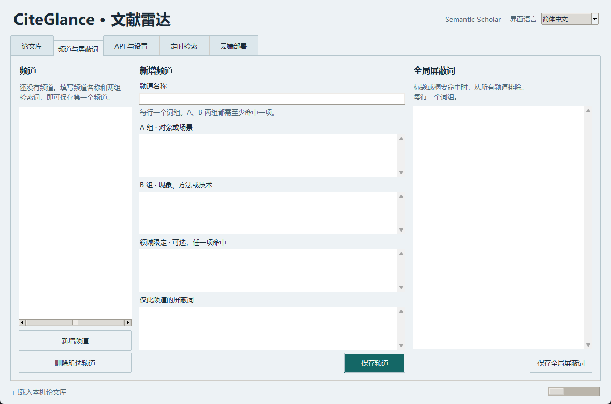
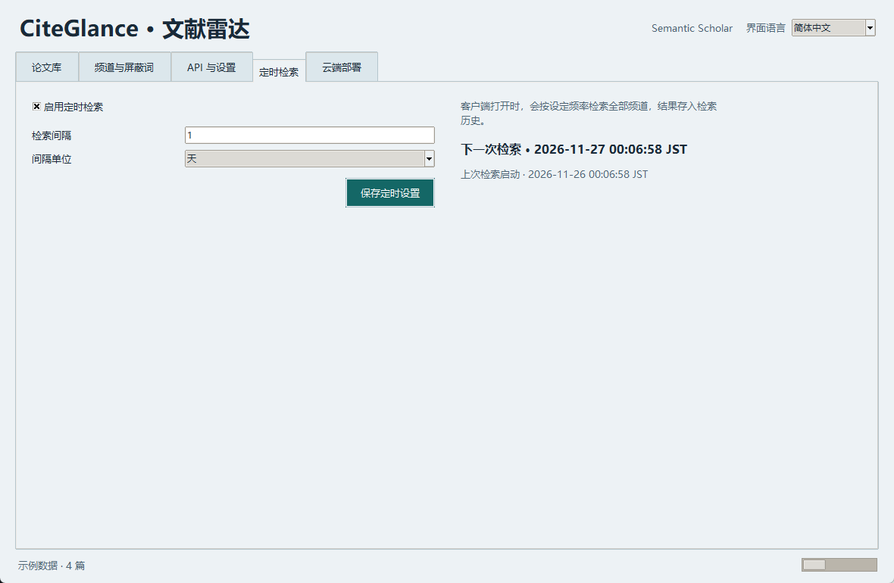

# CiteGlance 使用与部署指南

[返回项目首页](../README.md)

## Windows 客户端

双击 `launch_client.cmd`。也可以在项目目录运行 `python -X utf8 desktop.py`。需要 Python 3.10 或更新版本，以及 Python 安装时附带的 Tkinter。无需安装 Python 第三方包。

在窗口右上角的「界面语言」选择简体中文、English 或日本語。界面会立即切换并记住选择。摘要翻译的目标语言在「API 与设置」单独设置。

### 创建第一个频道

首次打开时，频道、检索词组和屏蔽词均为空。在「频道与屏蔽词」填写名称与 A、B 两组检索词，然后点击「保存频道」。每组至少命中一项即可。

「领域限定」是可选条件，填写后须再命中其中一项。「仅此频道的屏蔽词」和「全局屏蔽词」分别生效。频道设置写入项目里的 `channels.json`。

### 客户端定时检索

创建频道并配置检索来源后，默认每 24 小时检索一轮。在「定时检索」中可以设置分钟、小时或天为单位的间隔，或暂停定时检索。点击「保存定时设置」后立即应用。客户端使用当前保存的检索来源，自动检索所有频道，结果可在「检索历史」查看。

客户端保持打开且电脑处于唤醒状态时，最小化窗口也可继续定时。上次全频道检索的启动时间会记住，重开时已到期会运行一轮。手动搜索全部频道也会重新计算下一次时间。界面会以日本时间显示上次启动以及下次预计时间。每轮沿用「API 与设置」的请求预算，提高频率会增加每天的请求量。

需要关机后仍能定时检索时，可在「云端部署」页设置每日固定时间或间隔，部署到 Linux 云服务器。也可以使用下文的 GitHub 工作流。 [Linux 云端部署指南](server.md)

### 配置检索服务和密钥

1. 打开「API 与设置」，选择要使用的检索服务。Crossref 可以直接使用。选择默认的 Semantic Scholar 时，在「检索 API Key」填入该服务发给你的密钥。使用自己的 JSON 接口时，选择「自定义 JSON」，在配置框填写接口地址、查询参数、认证方式和字段映射，密钥填在独立的「检索 API Key」栏。
2. 点击「保存设置」。接口配置保存在当前 Windows 用户的 `%LOCALAPPDATA%\PaperWatch\settings.json`。Windows 客户端默认勾选「记住本次输入的密钥」，使用 Windows DPAPI 加密保存到同一目录的 `credentials.json`。取消勾选时，本次输入的密钥只在当前会话使用。自定义服务的密钥与接口地址绑定。
3. 回到「论文库」，选一个频道或「全部频道」，点「检索新论文」。点击论文可以查看摘要、来源提供的关键词、学科分类和实际命中的检索词。收藏、检索结果和已完成的译文保存在本机论文库。

### 摘要翻译

在「API 与设置」选翻译服务和目标语言，保存后，在论文详情点「翻译摘要」。目前可以翻成简体中文、日语或英语。原文和译文都会显示，重新打开已翻译的论文可以读到本机缓存。

| 服务 | 需要填写 |
| --- | --- |
| DeepL | 该服务发放的 API Key，以及 API Free 或 Pro 的完整 `/v2/translate` 地址 |
| OpenAI 兼容 | 完整 `/chat/completions` 地址、平台的模型名，以及服务要求的 API Key。本机运行的兼容服务也可配置 |
| LibreTranslate | 完整 `/translate` 地址。本机运行时可用默认的 `http://127.0.0.1:5000/translate`，所选语言需已安装。密钥取决于服务配置 |

点击翻译时，客户端只把当前摘要发送给所选翻译服务。选择本机翻译服务可以在本地完成这一步。客户端自身不包含翻译模型。

### 检索 API

客户端内置 Semantic Scholar、OpenAlex 和 Crossref，同时支持自定义 JSON API。手动和定时检索均使用「API 与设置」中保存的来源。命令行 `bot.py`、Docker 常驻服务和随仓库附带的 GitHub Actions 目前仅支持 Semantic Scholar。

Crossref 可用公开接口，按 A 组词获取候选并在客户端筛选，覆盖受候选结果与摘要可用性影响。OpenAlex 无密钥时客户端只尝试查第一页。各来源的搜索语法、结果量、摘要和关键词覆盖有所不同。

对于其他返回 JSON 的 HTTP API，选「自定义 JSON」并编辑配置框。界面自带示例，按目标 API 文档调整这些字段：

- `endpoint` 与 `method` 设置完整地址和 `GET` 或 `POST`。远程地址使用 HTTPS，本机地址可以使用 HTTP。
- `params` 与 `body` 设置查询参数和 POST JSON 请求体。可用 `{query}`、`{start_date}`、`{end_date}`、`{cursor}`。
- `auth` 设置密钥在请求头、查询参数或 JSON 请求体中的位置，并配置字段名及前缀。密钥填入独立的「检索 API Key」输入框。
- `items` 和 `next` 是列表和下一页标记的路径，例如 `results` 和 `meta.next_cursor`。`map` 关联论文标题、摘要、关键词等字段。`authors[].name` 可读取数组中所有对象的 `name`。根数组用 `$`。
- `query_style` 支持 `boolean`（AND / OR）、`semantic`（加号 / 竖线）或 `keywords`（空格分隔）。客户端仍会按频道规则过滤返回的标题和摘要。

需要 OAuth 登录、专有签名或 XML 响应的服务，需要新增一个专用适配器。

## GitHub 云端运行

仓库随附的 GitHub Actions 工作流使用 Semantic Scholar 检索、用 Telegram 发送简报。启用后默认每天 **09:07（日本时间）**运行，检索前一个自然日发表的论文。GitHub 定时任务可能延后，简报也受论文收录时间影响。

频道、A／B 组和屏蔽词位于 `channels.json`。每次运行最多发出 20 次检索请求，包含各频道的检索、翻页和重试。一次手动运行有独立预算。向 Semantic Scholar 发出的请求至少间隔 1.05 秒。程序只用 Python 标准库，要求 Python 3.10 或更新版本。

## 1. 创建 Telegram Bot

1. 在 Telegram 给官方 `@BotFather` 发送 `/newbot`，按提示创建并保存 Token。
2. 打开你刚创建的机器人私聊，发送 `/start`。
3. 解压项目，在项目目录打开终端并运行以下命令。它会以隐藏输入的方式读取 Token，然后显示机器人近期收到消息的私聊 ID。首次设置时，建议只有你自己向它发 `/start`。

~~~~powershell
python bot.py --chat-id
~~~~

## 2. 部署到 GitHub

1. Fork 此项目，或把源码上传到自己的 GitHub 仓库。保留 `.github/workflows/paper-watch.yml`，并在默认分支的 `channels.json` 中配置至少一个频道。希望频道配置仅自己可见时，使用私有仓库。
2. 在仓库的 **Settings → Secrets and variables → Actions → New repository secret** 添加以下三个值。工作流中出现的是 Secret 名称，实际密钥由 GitHub 在运行时提供。

   | Secret | 值 |
   | --- | --- |
   | `SEMANTIC_SCHOLAR_API_KEY` | Semantic Scholar 发放的 API Key |
   | `TELEGRAM_BOT_TOKEN` | BotFather 发放的 Token |
   | `TELEGRAM_CHAT_ID` | 上一步取得的私聊 ID |

3. 到 **Actions → CiteGlance 每日检索 → Run workflow**。首次保持「仅检索并预览，不发送 Telegram」勾选，在运行日志看检索结果。这一步需要 Semantic Scholar API Key。
4. 确认结果后，可以手动取消预览勾选运行一次，验证 Telegram 能收到简报。要启用日程，在 **Settings → Secrets and variables → Actions → Variables** 添加仓库变量 `PAPER_WATCH_CLOUD_ENABLED`，值设为 `true`。启用后每天由 GitHub 运行。重复手动运行会产生额外 API 请求。

要修改 GitHub Actions 的检索时间，在你的仓库默认分支编辑 `.github/workflows/paper-watch.yml` 的 `on.schedule`。Cron 前两项依次是分钟、小时。保留 `timezone: 'Asia/Tokyo'`，例如把 `cron` 改为 `'30 9 * * *'`，即每天日本时间 09:30。

云端密钥通过 GitHub Secrets 配置。桌面端可以使用 Windows 加密保存。命令行推送的历史保存在运行目录的 `state.json`，桌面端和 Docker 服务使用各自的 SQLite 数据库。GitHub Actions 只有仓库读取权限，每轮独立运行。同一天重复运行可能收到相同的论文，较晚收录的论文也可能超出检索范围。

## 检索和简报

- 每个频道分别执行「A 组任一词组 AND B 组任一词组」。程序再检查标题、摘要和屏蔽词。
- 常驻服务和命令行常规检索首次回看最近 14 个自然日，以后继续滚动回看，若任务长时间漏跑，则按各频道上次成功日期补查。Semantic Scholar 使用论文的出版日期字段，缺少精确日期或延迟收录超过窗口的论文可能遗漏。
- 同一篇论文通过 DOI、Semantic Scholar ID、arXiv ID 或规范化标题去重。跨频道结果合成一条。标题相同的预印本和正式版在同一轮出现时优先采用正式版。
- 简报包含论文标题、出版日期、渠道、匹配词组和 DOI 或 Semantic Scholar 链接。结果按频道分组，再按发表日期排序。
- 命令行常规推送和 Docker 服务在 Telegram 确认收到消息后保存论文记录。若接收消息后、保存状态前运行中断，下一次可能重复推送这一批。若某个频道的检索未完成，简报会标明，GitHub 运行状态也会显示失败。
- GitHub Actions 默认 20 次是**每轮**预算，提高运行频率前请重新核算每日请求量。

参考：[Semantic Scholar API](https://api.semanticscholar.org/api-docs) · [Telegram Bot API](https://core.telegram.org/bots/api) · [GitHub Actions 定时工作流](https://docs.github.com/en/actions/reference/workflows-and-actions/workflow-syntax#onschedule)
